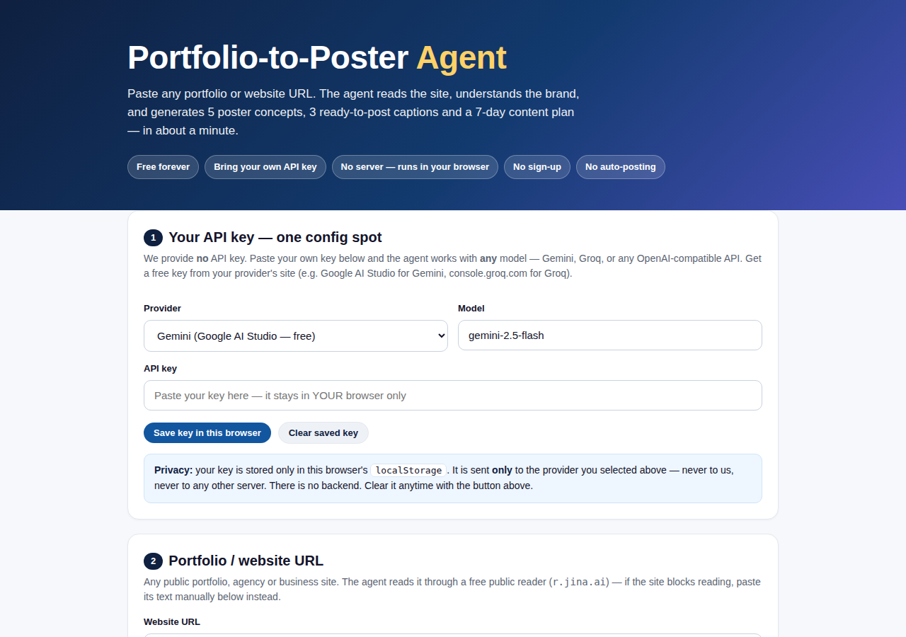
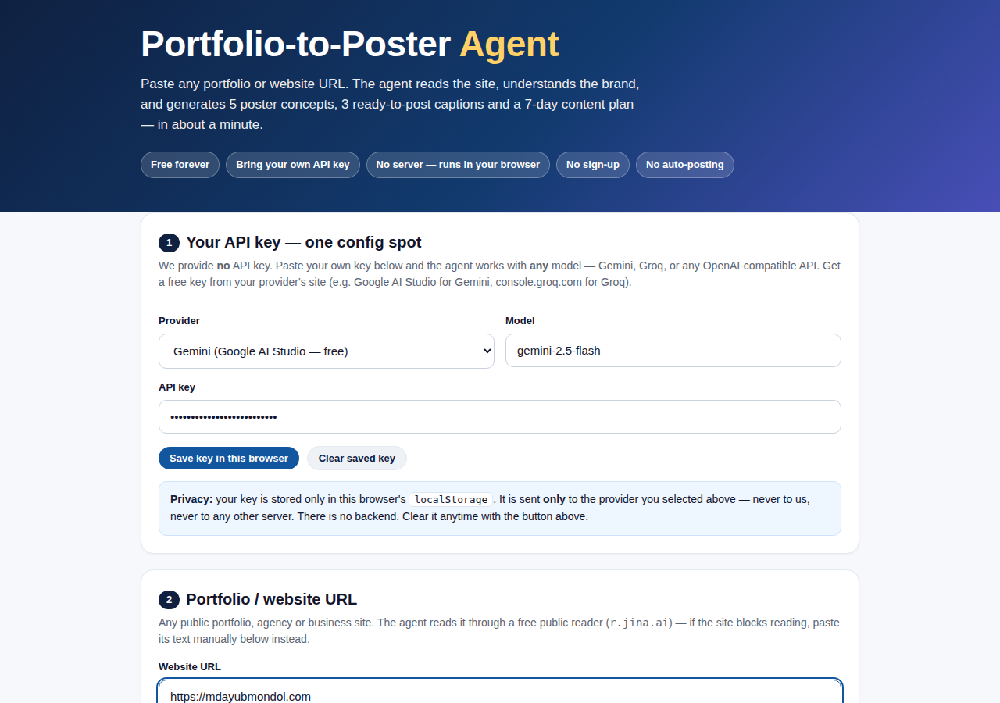
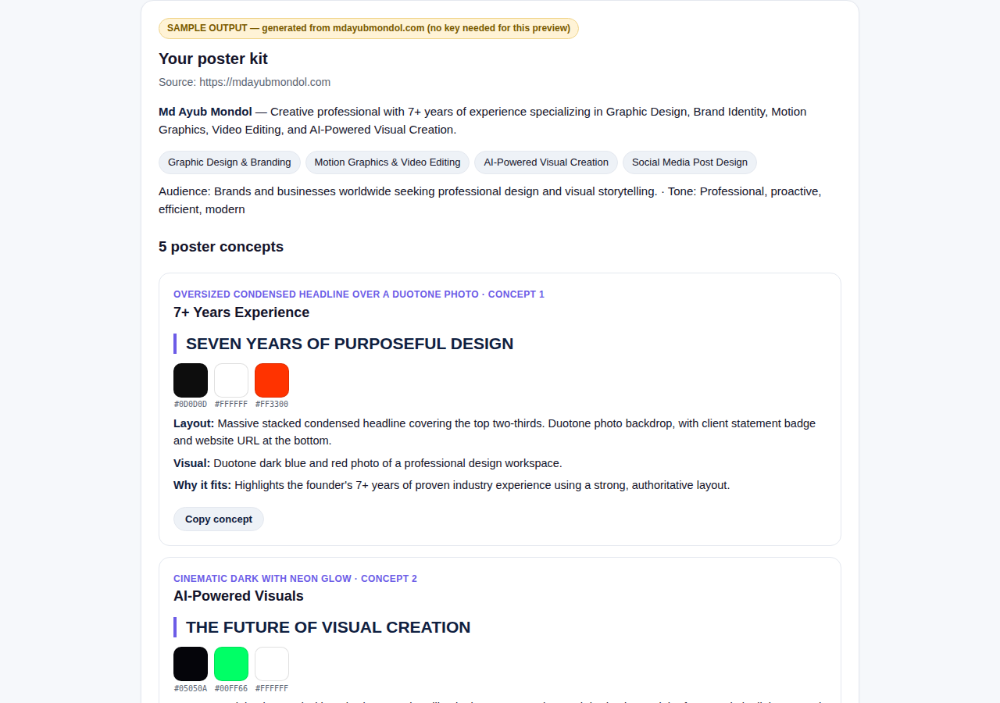
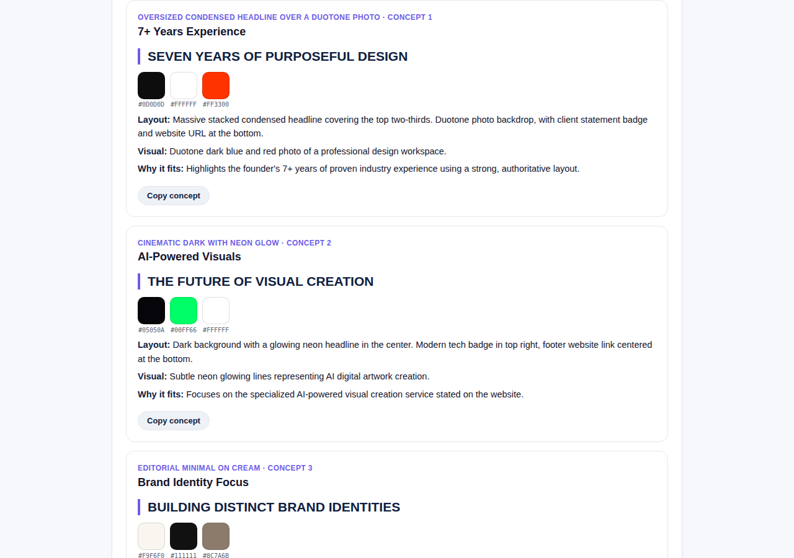
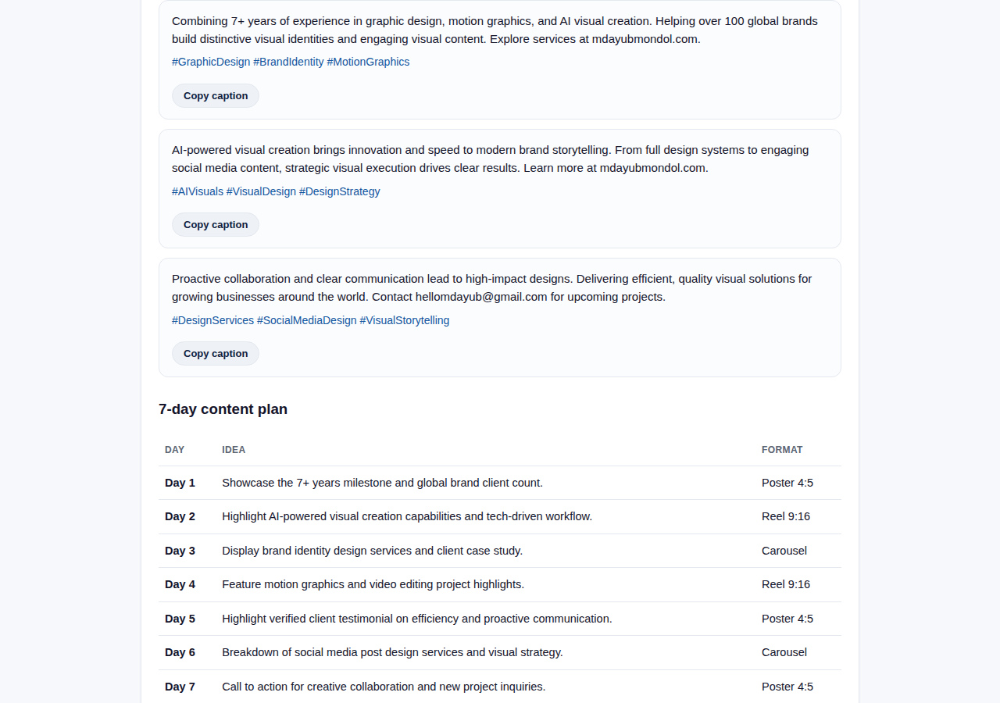
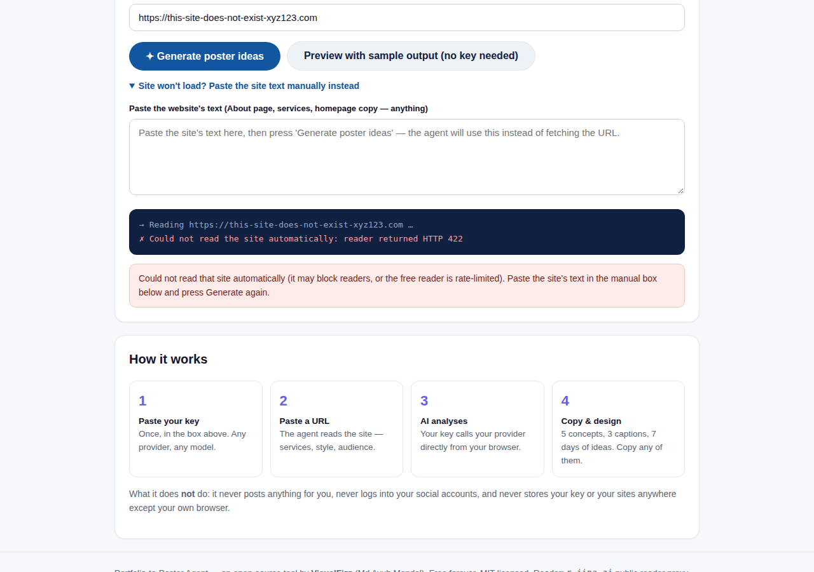

# Portfolio-to-Poster Agent — Workflow (please read before approving)

**What this is, in one line:** you paste any portfolio or website link, and the agent reads that site and gives you 5 poster ideas, 3 ready-to-post captions, and a 7-day content plan.

**What it costs:** nothing from us. The tool itself is free. It uses **your own API key** — you paste it once, and the AI provider you choose bills you (Gemini and Groq both have free tiers that cover this kind of use). We never give you a key, and we never see yours.

**No GitHub yet.** This is a preview only. Nothing is published anywhere until you approve it.

---

## The workflow — 6 simple steps

### Step 1 — Open the demo
Open `index.html` in a browser (or run `python3 -m http.server 8321` in this folder and visit `http://127.0.0.1:8321`). You see the page below — a headline, what the tool does, and two boxes.

### Step 2 — Paste your API key (the ONE config spot)
In box **1 "Your API key"**, pick your provider (Gemini, Groq, or OpenAI-compatible), paste **your own** API key, and press **"Save key in this browser"**.

- **Where do I get a key?** Gemini: Google AI Studio (free). Groq: console.groq.com (free tier). Any other provider that speaks the OpenAI format: their own site.
- **Where does my key go?** Only into **your own browser** (localStorage). It is sent **only** to the provider you picked — never to us, never to any other server. There is no backend at all. Press "Clear saved key" anytime to delete it.
- **Can I use any model's key?** Yes. Change the provider dropdown and the model name, and it works. That is the whole point of the design.

### Step 3 — Paste a portfolio / website URL
In box **2**, paste the link (for example `https://mdayubmondol.com`) and press **"✦ Generate poster ideas"**.

Behind the scenes the agent does this, and shows each step on screen:
1. Reads the site through a free public reader (`r.jina.ai` — it turns a webpage into plain text).
2. Cleans the text (removes menus, image links, navigation noise).
3. Sends the cleaned text + your key to **your** provider, with a fixed instruction: "use only facts from this site, make 5 different poster concepts, 3 captions, 7 days of ideas, answer in JSON".
4. Shows you the result.

### Step 4 — See your poster kit
You get four things, all on one page:

- **Brand snapshot** — name, what they do, services, audience, tone (all taken from the site).
- **5 poster concepts** — each one different: a headline (the exact words for the poster), a layout pattern, 3 colours with swatches, a visual idea, and why it fits this brand.

- **3 ready-to-post captions** — simple, professional, no "comment below" type questions.
- **7-day content plan** — one idea per day, with the format (poster 4:5, reel 9:16, carousel).

Every concept and caption has a **Copy** button. There is also a **"Copy everything as text"** button at the bottom.

### Step 5 — No key? Try the sample first
If you don't have a key yet, press **"Preview with sample output (no key needed)"**. It shows a real, already-generated kit for `mdayubmondol.com` so you can see exactly what the output looks like before you paste any key.

### Step 6 — If a site won't load
Some sites block automatic reading (or the free reader hits its limit — it happened to us during testing). The tool then shows a clear error and **opens the manual box by itself**: paste the site's text (About page, services, homepage copy) and press Generate again. The same agent runs on your pasted text.

---

## What the agent does NOT do

- It **never posts anything** for you — no auto-posting, no auto-comments, no logging into Facebook/Instagram/anything.
- It **never stores** your key or your sites anywhere except your own browser.
- It **never invents** facts about a brand — every claim must come from the site text. (If the site doesn't say it, the agent says so instead of guessing.)

## What we tested (summary — full log: TEST-LOG.md)

| Test | Result |
|---|---|
| mdayubmondol.com — full generation | ✅ Real output: 5 concepts, 3 captions, 7-day plan. "SEVEN YEARS OF PURPOSEFUL DESIGN", "TRUSTED BY OVER 100 BRANDS" — all facts from the site (verified: "100+ Brands" is on the homepage). |
| pentagram.com — full generation | ✅ Tailored output: "THIRTY SUMMERS IN THE PARK" (Paula Scher), "FIFTY SEASONS OF LIVE TV" (SNL) — real facts from their site. |
| sarasoueidan.com — full generation | ✅ Tailored output: "THE WEB IS FOR EVERYONE", "ALT TEXT IN CSS IS HERE" — real facts from her site. |
| Demo page in a real browser | ✅ No console errors (except the expected 422 from the reader when a site fails — handled). Favicon fixed. |
| Sample preview (no key) | ✅ Loads the real mdayubmondol.com output, clearly labelled SAMPLE. |
| Bad URL / site won't load | ✅ Clear error + manual paste box opens automatically. |
| Groq / OpenAI-compatible call | ⚠️ **Not tested with a live key** — code follows the standard OpenAI chat format, but no live key was available for testing. First run with a real Groq key will confirm it. |

## What happens after you approve

1. A **public** GitHub repo is created (per your rule: tools built for everyone = public), with the MIT licence, a README, and a support link — no API key anywhere in it.
2. The demo is hosted free (GitHub Pages) so anyone can open it in a browser.
3. The skill (`skills/portfolio-to-poster-agent/SKILL.md`) joins the `visualfizz-agent-skills` bundle so Claude Code / Cursor / Copilot / Gemini CLI users can use the same workflow.

## Files in this folder

| File | What it is |
|---|---|
| `index.html` | The whole demo — one file, no server, no build step |
| `sample-output.json` | Real generated output for mdayubmondol.com (used by the no-key preview) |
| `prompt-system.txt` | The exact instruction the agent sends to the AI |
| `skills/portfolio-to-poster-agent/SKILL.md` | The same workflow as an Agent Skills standard skill |
| `WORKFLOW.md` | This file |
| `TEST-LOG.md` | Full test results + honest faults |
| `screenshots/` | Screenshots of every step above |
| `prep-site.py`, `run-cli.py` | Test helpers (fetch + clean site text, run the prompt through the CLI) |
